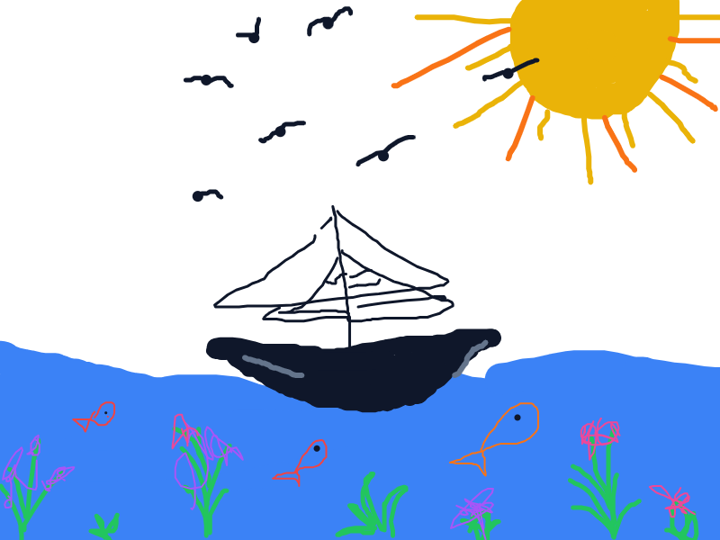
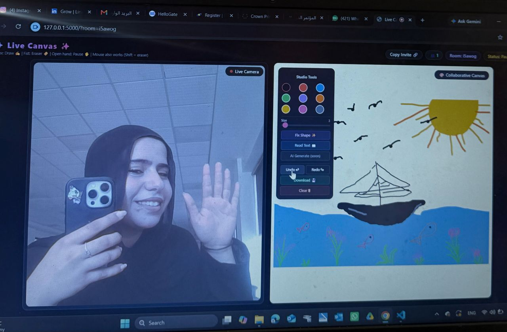
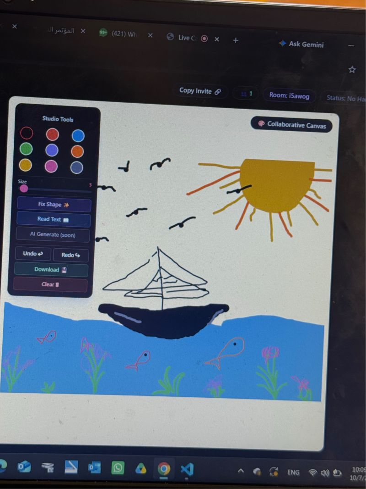

# ✨ Live Canvas

Draw in the air. Live Canvas is a browser-based drawing app you control with
hand gestures through your webcam, with real-time shared rooms so several
people can draw on the same canvas.



> The painting above was drawn entirely in the air with an index finger. No mouse, no pen.

## Features

- **Gesture drawing** using your webcam (MediaPipe Hands)
  - ☝️ Index finger up: draw
  - ✊ Fist: eraser
  - ✋ Open palm: pause
- **Mouse and touch support** as a fallback (hold `Shift` to erase)
- **Shared rooms**: send the invite link and draw together in real time
  (Socket.IO). People who join late get the existing drawing.
- **Synced Undo / Redo and Clear** across all users in the room
- **Fix Shape**: turns your last stroke into a clean line, circle, ellipse or rectangle
- **Read Text (OCR)**: recognizes written text on the canvas with Tesseract.js
- 9 colors, adjustable brush size, and PNG download

## Screenshots

|  |  |

## How it works

- MediaPipe Hands returns 21 landmarks per hand. A finger counts as extended when its
  tip is farther from the wrist than its middle joint, which keeps gestures reliable
  even when the hand is tilted.
- A gesture must repeat for 3 consecutive frames before it changes, and the fingertip
  position is smoothed, to reduce jitter.
- Every drawing action is stored as a **stroke** (color, size, points) rather than
  pixels. This is what makes Undo, Redo, eraser and late joiners work across users.
- The Flask + Socket.IO server relays strokes between clients and keeps each room's
  board in memory until the room is empty.

## Tech stack

Python, Flask, Flask-SocketIO, JavaScript, MediaPipe Hands, Tailwind CSS, Tesseract.js

## Running it locally

**Requirements:** Python 3.9+ and a webcam.

```powershell
git clone https://github.com/nooralshamasneh/LiveCanvas
cd LiveCanvas
python -m venv venv
venv\Scripts\python.exe -m pip install -r requirements.txt
venv\Scripts\python.exe app.py
```

Then open **http://127.0.0.1:5000** and allow camera access.

### Drawing with a friend

Click **Copy Invite 🔗** and send the link. Anyone who opens it joins the same room.

> Browsers only allow camera access on `localhost` or over HTTPS. Mouse and touch
> drawing work without the camera.

## Project structure

```
app.py               Flask + Socket.IO server (rooms and stroke relay)
templates/index.html UI, hand tracking, drawing and sync logic
requirements.txt     Python dependencies
screenshots/         Images used in this README
```

## Known limitations

- Boards live in server memory only, so they are lost when a room empties or the server restarts.
- OCR accuracy on handwriting is limited. Large, clear block letters work best.
- Runs on the Flask development server and is not hardened for public deployment.

## Roadmap

- [ ] AI image generation from the sketch
- [ ] Persistent boards
- [ ] More gestures (color switching, brush size)

## License

Copyright (c) 2026 Noor Alshamasneh. All rights reserved.

This repository is public for viewing and portfolio purposes only. The code may not
be used, copied, modified, distributed or sold without my written permission.
See [LICENSE](LICENSE).

## Author

**Noor Alshamasneh**: [LinkedIn](https://www.linkedin.com/in/noor-alshamasneh-a24880362/)
